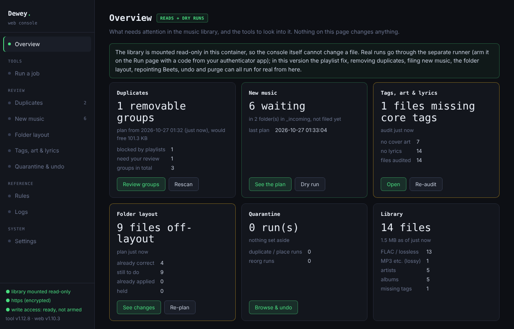
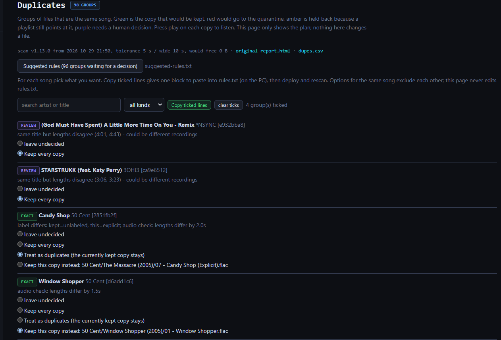
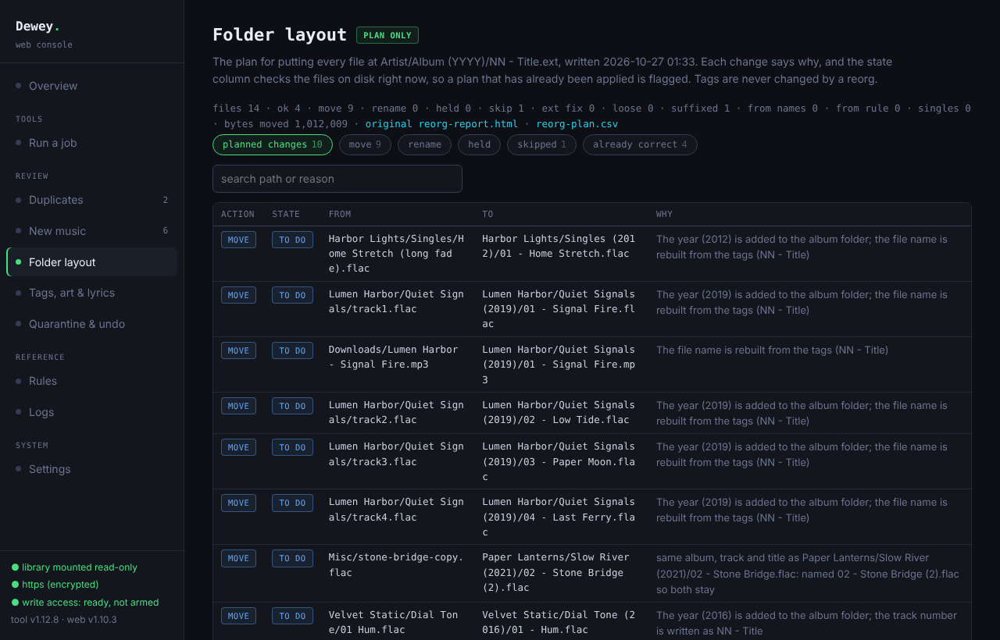
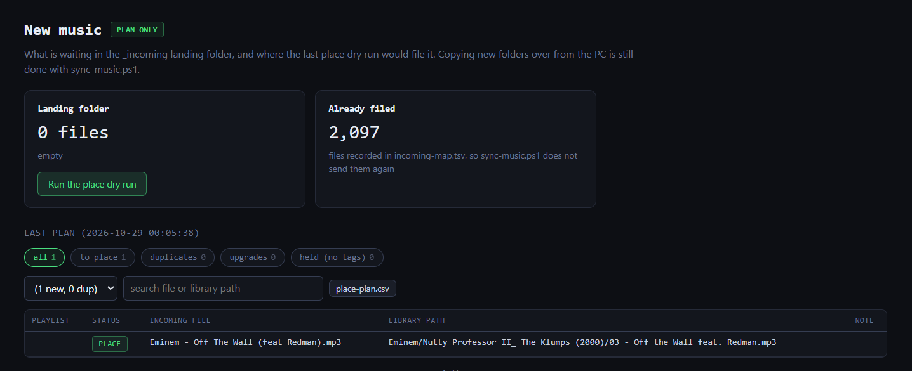
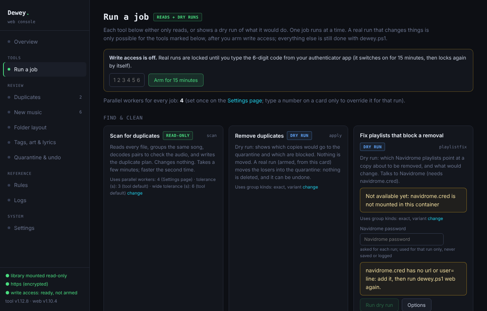

# Dewey

Dewey keeps a self-hosted music library in order. It finds the same song stored more than once, plans one folder layout for the
whole library, files new music into that layout, and keeps Navidrome's playlists and Beets' database pointing at the right files while it does so.
It is built around one rule: **nothing is changed until you have read a dry run, and almost nothing is ever deleted.**
Duplicates are *moved* to a quarantine folder outside the library, every move is recorded, and every run can be undone.
(The one exception is `purge`, which deletes old quarantine runs for good, behind the strictest gate of all.)

*Named after the Dewey Decimal system: every item has one right place on the shelf.*

Version: tool 1.13.0, web console 1.11.0.

## What it does

| Job | What it does | Changes files? |
|---|---|---|
| `scan` | Reads every file, groups the same song, decodes pairs of copies to check they really are the same audio, writes a report and a plan | no |
| `playlistfix` | Points Navidrome playlists at the copy that will stay, so a duplicate behind them can be removed | playlists only |
| `apply` | Moves the losing copies to the quarantine and rewrites the `.m3u` playlists that pointed at them | moves files |
| `place` | Files new music from a landing folder (`_incoming`) into the library, sets duplicates aside, writes playlists | moves files |
| `reorg`, `reorg-apply` | Plans, then applies, one folder layout for the whole library: `Artist/Album (YYYY)/NN - Title.ext` | renames files |
| `beets-remap` | Repoints Beets' `library.db` at the moved files, without re-importing | edits Beets' database |
| `undo` | Puts a quarantine, place or layout run back | moves files |
| `purge` | Permanently deletes quarantine runs older than N days | **deletes** |
| `tagaudit`, `nd-missing`, `compare` | Read-only: missing tags, art and lyrics; Navidrome's "Missing Files" explained; are these two files the same audio? | no |

## Try it first, on a demo library

`python3 demo/make_demo.py` builds a small made-up library (generated tones, invented artists, nothing of yours) with duplicates, a playlist
that blocks one of them, mis-named files and a landing folder of new music, so you can run every dry run and look at the web console before
pointing Dewey at real music. Step by step in [`demo/README.md`](demo/README.md).



| | |
|---|---|
|  |  |
|  |  |

## How it fits together

```
 PC (optional)                      NAS (Docker)
 ┌──────────────┐  ssh   ┌───────────────────────────────────────────────────────┐
 │ dewey.ps1    │ ─────► │ dewey.sh  → throwaway tool container (dewey.py)       │
 │ sync-music   │        │                                                       │
 └──────────────┘        │ dewey-web     web console, library mounted READ-ONLY  │
   phone / PC browser ─► │      │  request files only (Docker volume "queue")    │
   (https, tailnet)      │      ▼                                                │
                         │ dewey-runner  the ONLY container that can write       │
                         │               (no port, no web server, no socket)     │
                         └───────────────────────────────────────────────────────┘
```

- **The tool** (`dewey.py`, Python) does all the work. Run from `dewey.ps1` it starts in a throwaway container each time. Read-only commands and every dry run work this way.
- **The web console** (`webui.py`, `web/`) shows the library, the duplicate groups, the folder layout, tag gaps, the quarantine and logs, and can start any read-only job or dry run. It has the library mounted read-only and refuses any command line containing `--execute`.
- **The runner** (`runner.py`) is the only thing that can change the library from the browser, and only while it is *armed* (see "Real runs from the console").
- **Folders next to the library:** `_incoming` (new music waiting), `_dedupe-quarantine` (set-aside files, one folder per run, each with a `manifest.json`), `_reorg` (layout run journals and backups). `out/` holds reports, plans, caches, logs and playlist backups.
- **Files that stay on your own machines:** `.env` or `web.env` (console login and settings), `navidrome.cred` (Navidrome address and user), `rules.txt` and `dewey.config.psd1`. All are git-ignored; `tools/check_public.py` (run it by hand, or install its pre-commit hook with `--install-hook`) refuses a commit that contains one.

## The standard sequences

Every real run follows the same shape: **dry run, read it, run for real, check.** Run counts are confirmed by typing them; each dry run can authorise one real run, and only within 6 hours.

**1. Clean up duplicates**
1. `scan`, then read the report (or the Duplicates page). For songs you want treated differently, copy the lines you need from `suggested-rules.txt` (or tick them in the Duplicates page's **Suggested rules** panel) into `rules.txt`, and scan again.
2. `playlistfix` (dry run, then real): clears every file that was BLOCKED because a Navidrome playlist, star or rating pointed at it.
3. `scan` again, then `apply` (dry run, then real). Start with `--exact-only` or one artist.
4. Rescan Navidrome. Keep the quarantine for a few weeks, then `purge`.

**2. Add new music**
1. Put the files in `_incoming`: loose files, or a folder per playlist (the folder name becomes the playlist). From a PC, `sync-music.ps1` copies only what is new; from a phone, any SMB file manager works.
2. `place` (dry run, then real), then rescan Navidrome. Files without artist and title tags stay behind and are listed.

**3. Reorganise the folder layout** (one-off, or after a big import)
1. `reorg` writes the plan and a report; fix tags or add `reorg-*` rules, re-plan until it looks right.
2. `reorg-apply` in batches (`--limit`, `--artist`, `--album`), dry run then real. Navidrome's database is backed up first and the run stops if it cannot be.
3. Let Navidrome rescan. When the whole layout is done, **pause Beets' import task**, run `beets-remap` (dry run, then real), check with `beet ls -p | head`, re-enable the task.

**4. Take something back**
- `undo` a run from the Quarantine page or by manifest: dry run, then real. A run that was already undone has nothing left to restore.
- After undoing a layout run, run `beets-remap` again (it follows the move history backwards) and rescan Navidrome.

**5. Free the space** — `purge` deletes quarantine runs older than the limit (default 30 days, never under 7 for a real run). It cannot be undone, and the purged runs can no longer be undone either.

**After any real run:** rescan Navidrome; run Beets' import or `beet update -M` if you use Beets; check the run's log under `out/logs/` or the History on the Run page.

## Real runs from the console

Any of the real runs above can be done from the browser, including from a phone. The browser never gets write access itself:

1. On the Run page, do the **dry run** of the card and read the output.
2. **Arm** write access with the 6-digit code from your authenticator app. Arming lasts 15 minutes (`MD_ARM_MINUTES`) and ends by itself.
3. Type the confirmation shown on the card (`FIX PLAYLISTS`, `QUARANTINE n`, `PLACE n`, `MOVE n`, `REPOINT n`, `RESTORE n`, `DELETE n`, where n is the number from the dry run) and press **Run for real**.
4. **Disarm**, and check the result.

What the runner checks before it touches anything: it is armed; the command and every option are on its *own* fixed list (it does not trust the console's); the request names a finished dry run of the same command, no more than 6 hours old, that has not been used; the plan is unchanged since (by hash, or by a fingerprint for commands that plan from live state); the typed phrase matches; nothing else is running. The real run is that dry run's own recorded options plus `--execute`, so what you reviewed is what runs. The tool then refuses on its own if what it would do no longer matches the dry run.

## How the duplicate logic decides

- **exact**: same artist and title (remaster, `feat.` and version labels ignored), lengths within `tolerance` (3 s). Keep the best copy.
- **wide**: same, lengths 3 to 6 s apart (a remaster, a longer fade). Listed, **not applied** until you approve the group by naming it.
- **variant**: same song, different edit (radio edit, extended, single). One survives by `prefer-order` or a `prefer-edit` rule. **Lossless always wins:** a preferred edit that only exists as MP3 does not beat a FLAC.
- **review, similar, exempt**: shown in the report, never touched by `apply`. Live, acoustic, remix, instrumental, demo, karaoke and cover versions are different songs and never grouped. Copies crediting different featured artists are never merged.
- **Best copy:** your `keep-file` rule, then lossless and higher bit depth or bitrate, then more playlists, plays and stars, a tidier folder, not a compilation, fuller tags, earlier release, larger file.
- **Audio check:** before any copy is removed as a duplicate, both are decoded and compared. Only a pair whose audio matches all the way through is removed. A clean and an explicit edit (a muted or bleeped word) or a different master are left alone; anything that cannot be read is left alone too. Use `compare` on a pair you know to see what it thinks.
- **Protections:** a file in a Navidrome playlist the kept copy is not in, or that is starred or rated, is BLOCKED until `playlistfix` carries that over. `protect-path` files are never removed.

## Configuration

- **`dewey.config.psd1`** (PC launcher only; copy `dewey.config.example.psd1`): your NAS address, user and folders for `dewey.ps1` and `sync-music.ps1`. Stays on your PC.
- **`rules.txt`** (Compose: `data/config/rules.txt`; start from `rules.example.txt`): one `key: value` per line, then re-scan. Keys: `prefer-edit`, `prefer-order`, `keep-both`, `keep-both-id`, `keep-file`, `protect-artist`, `protect-path`, `skip-path`, `tolerance`, `wide-tolerance`, `clean-explicit`, `dedupe-labels`, `audio-check`, `keep-played`, `keep-album`, `place-upgrade`, `reorg-skip`, `reorg-various`, `reorg-unknown-album`, `reorg-artist`, `reorg-names`, `reorg-set`. The file is commented; the Rules page shows what each does.
- **`.env`** (Docker Compose, see `.env.example`) or **`web.env`** (PC launcher, on the NAS, see `web.env.example`): the console login (one pair per person), `MD_WEB_PORT`, `MD_WEB_BIND`, `MD_WEB_HOSTS`, `MD_ARM_MINUTES`, optional dashboard-tile token and network.
- **`navidrome.cred`** (Compose: `data/config/`; PC launcher: next to `dewey.sh` on the NAS): `url=` and `user=`; the tool asks for the password at each run. A stored `password=` line works but is a plaintext secret: protect the file and remove it when you can.

## Security in short

- Put the console behind HTTPS and keep it off the public internet (a tailnet or VPN; **never** a public tunnel). Bind the port to `127.0.0.1` and set `MD_WEB_HOSTS`. More under "Security" in `docs/SECURITY.md`.
- Login is HTTP Basic with a lockout after repeated failures; every POST needs a custom header and a same-origin check; the Navidrome password is accepted only over HTTPS.
- Writing needs *two* factors: the console login, and a code from an authenticator app that only the runner can check. A stolen login alone cannot change a file.
- **Honest limits:** the runner keeps the library writable for as long as it runs (there is no Docker socket to mount per job), so its safety is the arming and the checks, not the mount. A taken-over console could ask the runner for any allowed command with allowed options inside an armed window; that is why each run is also tied to a fingerprinted dry run and a typed count, and why quarantined files and backups exist. Someone with root on the NAS can do anything.

## Things to know before you rely on it

- **Tags are the source of truth.** Files are placed from their tags, never their names. A file with no artist or title is not placed. Duplicate detection also depends on tag quality; the dry runs show exactly what it decided and why.
- **Navidrome identifies a track partly by its tags.** Changing a title or album tag changes the track's id and loses its stars, ratings, plays and playlist spots. Dewey never writes tags, and `reorg` keeps the file name of tag-less files for the same reason. Tested against Navidrome 0.64.0; it reads Navidrome's database directly, so a major schema change could need an update.
- **Beets** keeps absolute paths and will see a moved file as new. Pause its import task during a layout change and run `beets-remap` before it resumes.
- **One job at a time.** The plan files and databases are single-writer; the console runs one job, and nothing runs while a real run does.
- **Interruptions are safe.** Every move is a whole-file rename on the same volume, and each run keeps its manifest current as it goes, so `undo` restores whatever had moved. `place` can simply be run again.
- **Back up first.** Dewey is careful, but it moves a lot of files. Keep a backup of the library and of Navidrome's and Beets' databases (Dewey also backs them up before editing them).
- **Not covered:** editing tags, fetching art or lyrics (it only audits them), copying music from a PC (that is `sync-music`, or any file manager into `_incoming`).

## Tests

`python3 tests/run_tests.py` runs the whole suite (the runner's safety checks, every real run, undo and purge, the demo library, and the web pages
in a real browser) against throw-away rigs, with no library, Navidrome or Docker needed. GitHub runs it on every push. Details in [`tests/README.md`](tests/README.md).

## Setting it up

Requirements: a machine running Docker with the library on one volume (a NAS, a home server); Navidrome (recommended: Dewey reads its database to protect what you play, star and put in playlists); Beets (optional); an authenticator app for real runs from the console. The image installs `ffmpeg`, `mutagen` and `numpy` itself. Back up the library first.

### Option A: Docker Compose (any Docker host)

```sh
git clone <this repository> dewey && cd dewey
cp .env.example .env            # then edit it: DEWEY_MEDIA, DEWEY_NAVIDROME_DATA, DEWEY_UID/GID, a console password
mkdir -p data/out data/config   # required on Synology (its Docker will not create missing folders); harmless elsewhere
docker compose up -d            # builds the image, starts the READ-ONLY console on http://127.0.0.1:8099
docker compose --profile tools run --rm dewey scan      # a command-line scan (read-only)
```

- **Folders:** Dewey keeps its reports and settings in `./data` (`data/out`, `data/config/rules.txt`, `data/config/navidrome.cred`). Edit `rules.txt` from `rules.example.txt`; for playlist jobs create `data/config/navidrome.cred` with `url=` and `user=`.
- **Who can write:** only the **runner**, and it is opt-in: `docker compose --profile runner up -d`. First time, show its authenticator secret with `docker compose --profile runner run --rm runner secret` and add it to your authenticator app. The console and the `dewey` service mount the library read-only. For command-line real runs use `docker compose --profile tools-write run --rm dewey-write apply --execute`.
- **Beets:** set `DEWEY_BEETS` and `COMPOSE_FILE=docker-compose.yml:compose.beets.yml` in `.env` (see `compose.beets.yml`).
- **Reaching the console from other devices:** keep `DEWEY_WEB_BIND=127.0.0.1` and put HTTPS in front of it (a reverse proxy, Tailscale Serve). Never publish it on the internet.
- **Updating:** `git pull`, then `docker compose build` and `docker compose up -d` (add `--profile runner` if you use the runner).
- The Compose files have been validated with `docker compose config`, and the code is covered by the project's tests; **running them on a real Docker host is still new**. Please report what you find.

### Option B: from a Windows PC with ssh (what the author runs on a Synology NAS)

```powershell
copy dewey.config.example.psd1 dewey.config.psd1     # then edit it: NAS address, user, folders
.\dewey.ps1 deploy            # copy the files to the NAS
.\dewey.ps1 scan              # first run builds the image; read-only
.\dewey.ps1 web               # start the console (read-only); optional web.env on the NAS (see web.env.example)
.\dewey.ps1 runner            # start the runner (only if you want real runs from the console)
.\dewey.ps1 runner secret     # the authenticator-app secret: add it in your phone's authenticator
```

Updating: `.\dewey.ps1 deploy`, then `.\dewey.ps1 runner` if `runner.py` or the mounts changed, then `.\dewey.ps1 web`, then a hard refresh in the browser. `web [up|stop|logs|status]` and `runner [up|stop|logs|status|secret|newsecret]` manage the containers. Everything also runs with `bash dewey.sh <command>` on the NAS.

Keep these together in one folder on the PC: `dewey.ps1`, `dewey.py`, `dewey.sh`, `Dockerfile`, `rules.txt`, `webui.py`, `web/`, `runner.py`, `sync-music.ps1` (optional, copies new music from a PC) and your `dewey.config.psd1`.

## Troubleshooting

- `navidrome.db not found`: pass `-NdData <folder holding navidrome.db>` to `dewey.ps1`, or set `MD_NDDATA` when running `dewey.sh` directly.
- Changed the `Dockerfile` (PC launcher): `MD_REBUILD=1`. With Compose: `docker compose build`. `dewey.sh` must have LF line endings (`dewey.ps1` writes it that way).
- The console says write access is off, or a card's "Run for real" is greyed out: the runner is not running, it is not armed, or there is no usable dry run of that card (finished OK, under 6 hours old, not already used, and it must be the newest one).
- A real run refused with "REFUSED": the library, a plan or a database changed after the dry run. Nothing was changed; do a fresh dry run.
- The console looks out of date after an update: it needs `.\dewey.ps1 web` and a hard refresh.
- Run logs: the History on the Run page, the Logs page, or `out/logs/` on the NAS. `runner logs` lists every arming, wrong code and real run.

## About this project

**Built with AI.** Built by the author with extensive help from Claude; all code is tested, reviewed and run by the author.

**Support.** Maintained as a hobby. At most one release every two weeks; fixes arrive in releases, not as individual patches. Issues are welcome, but replies and fixes may be slow.

**Contributing.** Bug reports with a dry-run log are the most useful thing you can send; see [`CONTRIBUTING.md`](CONTRIBUTING.md). Please report security problems privately, as described in [`SECURITY.md`](SECURITY.md). Changes are listed in [`CHANGELOG.md`](CHANGELOG.md).

**No warranty.** Dewey moves your files. It is built so that nothing is changed without a dry run you have read and almost nothing is deleted, but back up your library first (see "Things to know before you rely on it").

**License.** [MIT](LICENSE).
